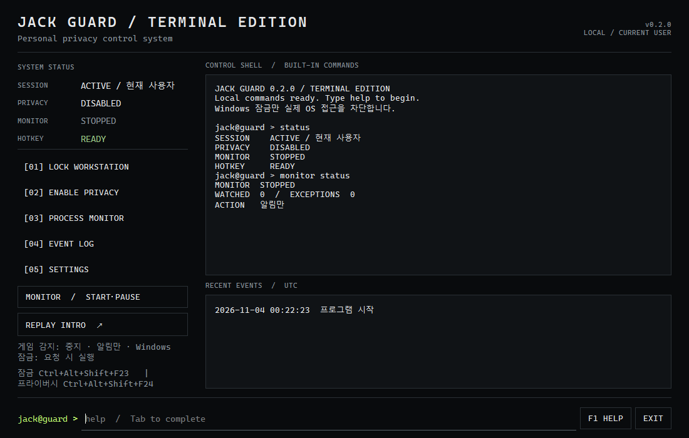
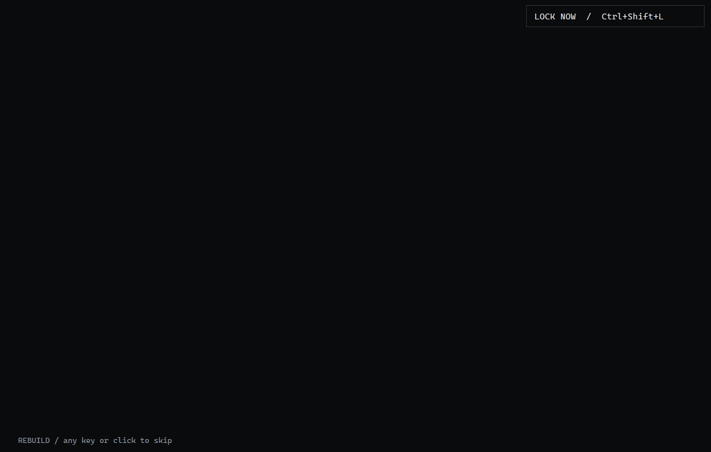
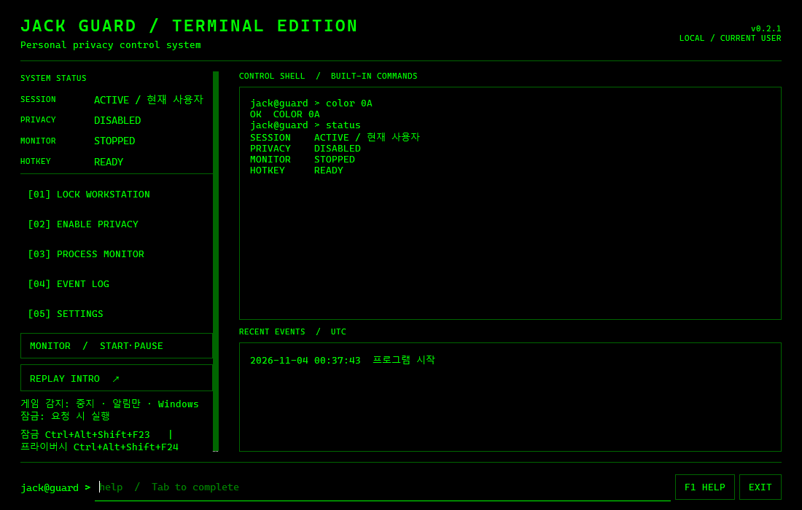

# JACK GUARD / TERMINAL EDITION

Windows 10 (1809 이상)/11 x64용 한국어 개인 프라이버시 보조 도구. 관리자 권한 없이 실행합니다.
Python 3.12 · PySide6(Qt Widgets) · psutil · PyInstaller.

**현재: 로컬 0.2.1 Terminal Edition 배포 후보. GitHub 공개 및 라이선스 선택 승인 전입니다.**
공개 저장소·실제 Release·서명된 파일이 존재한다고 주장하지 않습니다.





캡처에는 검증 전용 단축키가 표시되어 있습니다. 일반 실행 기본값은 아래 표와 같습니다.

## Control shell

명령 입력은 Windows 셸이 아닌 JACK GUARD의 제한된 내장 명령 인터페이스입니다.
GUI와 같은 잠금·감지·프라이버시·설정 보호 백엔드를 사용합니다.

```text
help                 status               lock
privacy on           privacy off
monitor status       monitor on           monitor off
process list         logs                 logs clear
settings             version              clear             exit
color                color /?             color 0A
```

Tab으로 명령을 완성하고 ↑/↓로 메모리 내 최근 100개 명령을 탐색합니다.
F1은 도움말, Ctrl+K는 입력 포커스, Esc는 입력 취소입니다.
`process list`는 현재 사용자 프로세스를 비동기로 조회합니다.
`logs clear`와 감지 설정 변경에는 기존 설정 비밀번호 보호가 적용됩니다.
PowerShell·CMD·시스템 명령 실행이나 셸 확장은 지원하지 않습니다.

### CMD-style COLOR



`color 0A`는 검정 배경/밝은 녹색, `color 1F`는 파란 배경/밝은 흰색,
`color F0`는 흰 배경/검정 글자를 적용합니다. 한 자리 `color A`도 지원합니다.
두 자리의 첫째는 배경, 둘째는 글자이며 0~9/A~F를 대소문자 구분 없이 받습니다.
`color /?`는 16색 표를 표시하고, `color`만 입력하면 앱 시작 시 기본 테마로 복원합니다.
동일한 두 자리 코드는 기존 색상을 유지하고 ERRORLEVEL 1을 표시합니다.
현재 창과 Replay에만 적용되며 사용자 설정에 저장하거나 Windows/CMD 설정을 바꾸지 않습니다.
색 이름·코드와 복원/오류 동작은 [Microsoft COLOR 문서](https://learn.microsoft.com/en-us/windows-server/administration/windows-commands/color)를
참고했으며 실제 RGB는 클래식 16색 표를 사용합니다. Windows Terminal의 사용자 지정 팔레트와는 다를 수 있습니다.

## Swarm interaction

앱 내부 QPainter로 5개 가상 커서가 실제 UI 영역을 순차적으로 조립합니다.
기본 인트로는 약 2.8초, 첫 실행에만 재생합니다. 트레이 복원에는 재생하지 않습니다.
Animation 탭에서 활성화·매 실행 재생·자동 모션 감소·1x/2x/3x·3/5/8개 커서를 설정합니다.
Replay는 저장된 설정으로 실행합니다. Windows 모션 감소 설정은 항상 우선합니다.
아무 키나 클릭하면 즉시 건너뛰고, 인트로 중에도 `Ctrl+Shift+L` 또는 LOCK NOW 버튼으로
실제 Windows 잠금을 요청할 수 있습니다. 일반 전역 잠금 단축키도 유지됩니다.
애니메이션 완료 후 렌더 타이머를 정지하며, 느린 프레임이 지속되면 자동 완성 화면으로 전환합니다.
실측 성능과 배율별 검증 범위는 [Terminal 검증 기록](docs/TERMINAL_QA.md)에 있습니다.

## 사용

공개 승인 및 배포 후 저장소 Releases에서 `JACK-GUARD-portable.zip`을 받아 **전체 압축을 풀고**
`JACK-GUARD/JACK-GUARD.exe`를 실행하세요. Python 설치가 필요 없습니다.
단일 `JACK-GUARD.exe`도 제공하도록 빌드를 구성했습니다.
ZIP 버전은 Qt DLL 교체가 가능하고 시작이 빠르므로 우선 권장합니다.
이 프로그램은 서명되지 않았습니다. Windows SmartScreen 경고가 나올 수 있습니다.
신뢰할 수 있는 배포처와 SHA256을 확인하고 조직의 보안 정책을 따르세요.

첫 실행에서 설정을 열고 감시할 게임의 **실행파일 전체 경로**를 추가한 뒤 감지를 활성화하세요.
기본값은 감지 중지, 자동 종료 해제, 자동 시작 해제입니다.

| 기능 | 기본 조작 |
| --- | --- |
| Windows 잠금 | 버튼 또는 `Ctrl+Alt+L`; 해제는 Windows 인증 |
| 프라이버시 모드 | `Ctrl+Alt+P`; 창 숨김, 선택적으로 모든 화면 가림 |
| 복원 | 트레이 클릭 또는 화면 가림의 해제 버튼 |
| 창 닫기 | 트레이로 숨김; 완전 종료는 종료 버튼 또는 트레이 메뉴 |
| 게임 감지 | 설정에서 전체 .exe 경로와 예외 목록 지정 |
| 감지 일시 중지 | 메인/트레이 버튼; 설정 비밀번호가 있으면 확인 필요 |
| 자동 종료 | 별도 경고 동의 후 저장한 경우에만; 데이터 손실 주의 |
| 로그 | 설정 → 로그에서 조회·삭제; 보존 기간 1~365일 |

화면 가림은 Windows 잠금이 아닙니다. Alt+Tab·작업 관리자 등으로 해제할 수 있습니다.
설정 비밀번호는 앱 설정 화면의 실수 방지용 보호이며 OS 접근 통제가 아닙니다.
앱 종료는 비밀번호로 막지 않습니다. 네트워크 전송·자동 업데이트·원격 제어가 없습니다.
실행파일 이름만 비교하지 않으므로 런처와 실제 게임 실행파일은 각각 등록하세요.

## 데이터와 복구

기본 경로: `%LOCALAPPDATA%\JACK-GUARD`.
설정은 임시 파일·fsync·원자적 교체로 저장합니다. 폴더 ACL은 현재 사용자와 SYSTEM으로
제한합니다. 관리자나 같은 사용자 권한의 다른 앱을 차단하는 보안 경계는 아닙니다.
로그에는 이벤트 시각(UTC), 이벤트 종류, 게임 파일명/PID 및 결과만 기록합니다.
키 입력, 화면 내용, 비밀번호, 전체 게임 경로는 로그로 수집하지 않습니다.

비밀번호 분실 또는 설정 손상 시 앱을 **완전히 종료**하고 다음을 실행하세요.

```powershell
.\JACK-GUARD.exe --reset-settings
```

확인 창에서 동의하면 설정·비밀번호·자동 시작을 초기화하고 로그는 보존합니다.
현재 사용자로 설정 파일을 바꿀 수 있다는 사실을 숨기지 않는 로컬 복구 방식입니다.
가져오기는 기존 비밀번호를 보존하고 감지·자동 종료를 비활성화합니다.
내보내기는 비밀번호 해시와 자동 종료 활성화를 제외합니다.
정상/충돌 종료 후 재실행하면 오래된 단일 실행 잠금이 자동 복구됩니다.

## 개발 및 검증

```powershell
py -3.12 -m venv .venv
.\.venv\Scripts\Activate.ps1
python -m pip install -r requirements-dev.lock
python -m pip install --no-deps -e .
ruff check .
ruff format --check .
python -m pytest -q
python -m jack_guard
python scripts/build.py
python scripts/smoke.py dist/JACK-GUARD.exe
```

실제 화면 캡처·성능 측정: `python scripts/visual_qa.py --output work/visual --data-dir work/data --gif`.
검증 폴더와 임시 단축키만 사용합니다. `QT_SCALE_FACTOR=1/1.25/1.5/2`로 Qt 배율을 바꿔
레이아웃을 검사할 수 있습니다. Windows 디스플레이 설정을 직접 변경하는 테스트와는 구분합니다.

`dist/`에 단일 EXE, Portable ZIP, `SHA256SUMS.txt`가 생성됩니다.
소스 실행 시 전용 가상환경 설치 경로를 이동하면 자동 시작을 다시 설정하세요.
다른 앱과 단축키가 충돌하면 설정을 적용하지 않으며 메인 화면에 오류를 표시합니다.
일부 단축키는 Windows가 예약하므로 다른 조합을 선택하세요.

CI는 Windows 빌드·Ruff·pytest·패키지 스모크 및 아티팩트 업로드를 수행합니다.
`v*` 태그 워크플로는 버전·라이선스·테스트를 확인하고 Release 자산을 첨부합니다.
Action은 커밋 SHA로 고정하며 PR 권한은 읽기 전용, Release 작업만 contents:write입니다.
태그 생성은 공개 릴리스를 발행하므로 소유자의 승인을 받은 후 진행하세요.
실제 실행 결과 및 미실행 항목은 [Terminal 검증 기록](docs/TERMINAL_QA.md)을 참고하세요.

## 라이선스와 한계

프로젝트 라이선스는 **소유자 선택 대기**입니다. MIT는 제안만 되어 있습니다.
Qt/PySide6는 LGPLv3 등 별도 조건을 따릅니다. [제3자 고지](THIRD_PARTY_NOTICES.md),
[보안 한계](SECURITY.md), [사용 설명서](docs/USER_GUIDE.md)를 확인하세요.
영어 문자열 확장 구조가 있으며 현재 전체 인터페이스는 한국어입니다.
앱 내 자동 업데이트 확인은 미구현이며 공개 후 Releases에서 수동 확인합니다.

최소 OS 범위는 [Qt 6.10 공식 지원 플랫폼](https://doc.qt.io/qt-6.10/supported-platforms.html)에
따릅니다. 모든 Windows 10/11 버전에서 수동 검증했다는 의미는 아닙니다.
